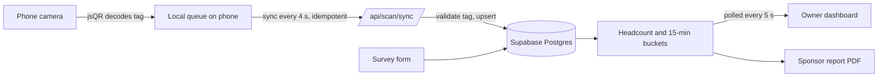

# Bullasoft Platform

**Event intelligence for promoters: verified attendance, audience data and a sponsor-ready report from one live dashboard.**

Built end to end by [Thabang Kgatlhanye](https://github.com/your-username) (Bullasoft). Next.js · TypeScript · Supabase (PostgreSQL) · Vercel.

> **Status:** live and tested for its first real event, KWA GOGO by Skyfall Entertainment, on 1 November 2026 (about 400 expected guests). Results will be added here after the event.

<!-- Add 3 screenshots here: dashboard, scanner, sponsor report -->

---

## The problem

Event promoters sell sponsorships on claims: "400 people, mostly 25–34, who spend well." Sponsors have learned not to trust them, because the only number organisers usually have is tickets sold, not people who came. Most also have no data on who their audience is, and they send no proof afterwards, so sponsors don't renew.

## What it does

| Stage | What happens | Output |
|---|---|---|
| **Before** | Attendees complete a short survey and join the mailing list | Audience profile |
| **At the gate** | Staff scan a QR tag on each guest with an ordinary phone, even with no signal | Live headcount and arrival curve |
| **After** | One click produces a printable report | Sponsor proof, PDF |

The owner signs in to a live dashboard. Gate staff get a separate scanner-only login that cannot reach any data.

## Engineering highlights


- **Offline-first ingestion with exactly-once counting.** Scans are saved on the phone first, then synced every 4 seconds. Each scan carries a client-generated id with a unique constraint, and the server upserts with `ignoreDuplicates`, so a retry or a double sync can never inflate the count. The server confirms which ids are safe to forget, so a failed save loses nothing.
- **Defensive validation on the server.** Phones check codes locally for instant feedback, but the server re-checks every code against the event's `tags` table and rejects unknown ones. A scan timestamp from a wrong phone clock is clamped so it cannot land in the future.
- **A clear metric definition.** Headcount is the number of *distinct* tags scanned, counted at their first scan. Re-scans are recorded but not counted, and shown separately.
- **Time-series bucketing.** Arrivals are grouped into 15-minute slots from the scan time (not the sync time), with empty slots zero-filled so the curve is continuous. The report derives milestones from it (when 25/50/75/90% of the crowd were inside).
- **Multi-tenant security.** Roles (`owner`, `scanner`) live in `org_members`. Every server query resolves the caller's organisation first and filters by it, and the privileged database client is used only after that check.
- **Survey analytics that picks the right chart.** Answers are stored as `jsonb`. A summariser counts each question and chooses the chart from the data shape: ordered scales get columns, small single-choice questions get a donut, multi-choice and long lists get ranked bars. Charts are hand-built SVG, so they work in light and dark mode and print cleanly.
- **Data quality at the database.** A unique index on normalised email and phone enforces one entry per person for the prize draw.
- **Privacy by design (POPIA).** Dashboards and reports show aggregates only, never individual answers. Sponsors receive contact details only through a separate opt-in.
- **Honest claims.** The report states what the data can and cannot prove: it measures entries, not dwell time or per-person spend.

## Architecture



| Layer | Choice |
|---|---|
| App | Next.js 14 (App Router), React 18, TypeScript |
| Data | Supabase: PostgreSQL, Auth, row-level security |
| Scanning | Browser camera + `jsqr`; tags generated with `qrcode` |
| Charts | Custom SVG components |
| Hosting | Vercel |

**Main tables:** `organisations`, `org_members`, `events`, `tags`, `door_scans`, `survey_responses`, `subs`.

## Tested

- Scanner decoded 200 of 200 generated codes in a test run.
- Verified on computer and phone: valid, duplicate and invalid tag states, live headcount, arrival curve.
- Verified offline: scans queue with no signal and sync on reconnect without double counting.
- Role lock verified: the scanner login cannot open the dashboard, tags or report.

## Trade-offs I made on purpose

- **Polling instead of WebSockets.** The dashboard refreshes every 5 seconds. It is simpler and more dependable on weak mobile signal, and that is live enough for a gate.
- **Bucketing in TypeScript, not SQL.** Easy to read and test at hundreds or thousands of scans. At larger volumes I'd move it to a `date_trunc` view.
- **Entry scans only.** No exit scan, so no dwell time. That is a known limit, stated in the report.

## Roadmap

- [x] Multi-tenant auth and role enforcement
- [x] Survey analytics, light and dark mode
- [x] Offline-first scanner with duplicate protection
- [x] QR tag generator and printable tag sheet
- [x] One-click sponsor report
- [ ] On-site drill at the venue before 1 Nov 2026
- [ ] Yoco card-sales import, to compare actual spend with attendance
- [ ] Social engagement tracking (tracked links, sponsor QR counter, analytics import)
- [ ] Invite and set-password pages
- [ ] Automated report delivery
- [ ] PostgreSQL views for aggregation as volume grows

## Run it locally

```bash
git clone https://github.com/your-username/bullasoft-platform.git
cd bullasoft-platform
npm install
```

Create `.env.local` (never commit this file):

```env
NEXT_PUBLIC_SUPABASE_URL=https://your-project.supabase.co
NEXT_PUBLIC_SUPABASE_ANON_KEY=your-anon-key
SUPABASE_SERVICE_ROLE_KEY=your-service-role-key
```

```bash
npm run dev
```

Open http://localhost:3002. Pages: `/dashboard`, `/scan`, `/tags`, `/report?event=<slug>`.

## Skills demonstrated

Data modelling · idempotent ingestion · offline-first design · time-series aggregation · multi-tenant access control · data visualisation · data privacy (POPIA) · full-stack TypeScript · product thinking for a real client.
