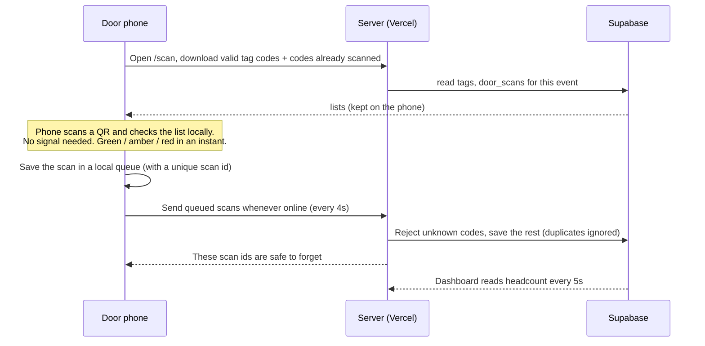

# Floq

**Event intelligence for event owners.** Owners sign in to a private dashboard and see who is coming to their
event (pre-event survey), who is on their mailing list, where sign-ups came from, and a **live headcount from the
gate**, all from data the event owner collected first-hand.

It is built and owned by Bullasoft, and Skyfall Entertainment (KWA GOGO, SKYFALL, Back2Back) is the first client.


---

## 1. The problem and the idea

Event promoters are asked by sponsors one question: **"who is your audience, and can you prove it?"** Most answer
with a guess, or with ticket-platform numbers they don't own.

This product helps an event owner:

1. **Collect first-party data** before the event (mailing-list sign-up, pre-event survey) with consent.
2. **Count people at the gate** in real time with QR tags, without needing perfect signal.
3. **See it all in one dashboard** and turn it into numbers a sponsor can trust ("of 230 respondents, 83% are
   25-34, 100% want Amapiano").
4. Later: connect sales (Yoco) and web analytics (GA4) so the owner can show audience *and* spend.

The long-term goal is to make this a data product: a repeatable pipeline from raw event data to a user-facing
dashboard, usable by any event company, not just Skyfall.

---

## 2. How the pieces fit together

There are **two apps** sharing **one database**:

```
   PEOPLE GOING TO THE EVENT                     EVENT OWNER / DOOR STAFF
            |                                               |
            v                                               v
  +----------------------+                      +------------------------+
  |  Skyfall website     |                      |  Floq    |
  |  (Next.js, Vercel)   |                      |  (this repo, Vercel)   |
  |                      |                      |                        |
  |  - subscribe         |                      |  - login (roles)       |
  |  - pre-event survey  |                      |  - owner dashboard     |
  |  - contact form      |                      |  - gate scanner        |
  |  - unsubscribe       |                      |  - tag generator       |
  +----------+-----------+                      +-----------+------------+
             |  writes (server routes)                      |  reads / writes (server routes)
             v                                              v
        +----------------------------------------------------------+
        |                 Supabase (Postgres + Auth)               |
        |  subs | survey_responses | contact_messages              |
        |  organisations | events | org_members | tags | door_scans |
        +----------------------------------------------------------+
```

- The **Skyfall site** is the public face. Visitors never log in; they sign up and answer the survey.
- The **Floq** is private. Only people an admin created can sign in.
- **Supabase** is the single source of truth. Both apps read and write the same tables, which is why a survey
  answer given on the website shows on the dashboard within seconds.

### Why a separate app for the platform?

The public site and the private platform have different audiences, security needs and release cycles. Keeping them
apart means a mistake on the marketing site can never expose owner data, and the platform can later serve many
clients, not just Skyfall.

---

## 3. Who can do what (roles)

Every signed-in person belongs to **one organisation** with **one role**, stored in `org_members`.

| Role      | Lands on     | Can do                                                                 |
|-----------|--------------|------------------------------------------------------------------------|
| `owner`   | `/dashboard` | See the dashboard, create tags, print tag sheets, use the scanner      |
| `scanner` | `/scan`      | Use the scanner only. Cannot open the dashboard, tags or any numbers   |

**Multi-tenant by design.** Every table carries an `org_id`, and every server query filters on the signed-in
person's `org_id`. Another organisation's data is unreachable even if someone edits a URL. This is what lets the
same platform serve many event companies.

---

## 4. What each screen does

| Page / route          | Who     | What it does                                                                                   |
|-----------------------|---------|------------------------------------------------------------------------------------------------|
| `/login`              | anyone  | Email + password sign-in (sign-ups are switched off; accounts are created by an admin)         |
| `/dashboard`          | owner   | Event picker, live headcount, survey charts, mailing list numbers, sign-up sources, messages   |
| `/tags`               | owner   | Create QR tag codes for an event                                                               |
| `/tags/print?event=x` | owner   | Printable sheet of QR tags (black on white, A4, cut along dotted lines)                        |
| `/scan`               | both    | The gate scanner: camera QR scan, typed fallback, works offline                                |

### The dashboard

- **Live headcount**: people through the gate, arrivals in the last 15 minutes, re-scans, last scan time, and an
  arrivals curve in 15-minute buckets. Refreshes every 5 seconds and says plainly when it can't reach the server.
- **Survey results**: one chart per question, chosen to suit the data:
  ordered scales (age, group size, arrival, spend) are **column charts** in their natural order; the
  "been before?" question is a **donut**; multi-pick questions (drinks, music) and "where from" are **ranked
  bars** because multi-pick answers add up to more than 100% and cannot honestly be a pie.
- **Mailing list**: active subscribers, growth in the last 7 days, unsubscribed count. Totals only; the dashboard
  never lists subscriber emails.
- **Where sign-ups came from**: from `utm_source` tags on shared links (e.g. Instagram vs WhatsApp).
- **Latest messages**: contact-form messages sent to the owners.
- **Light and dark mode** with a toggle that remembers the choice.

---

## 5. How gate scanning works (the core feature)

**Goal:** count people through the gate in real time, even when the phone has no signal, and never count anyone
twice.

### Tags

- An owner creates, say, 260 tags under **Tags**. Each tag is a random **8-character code** (e.g. `K7Q2XM4B`)
  from a 32-character alphabet with no `0/O/1/I`, so a code typed by hand is hard to get wrong.
- Each code is printed as a **QR code** with the code written underneath. If a QR is scuffed, staff type the code.
- Codes are stored in the `tags` table, tied to one event.

### One scan, step by step



### The three results

| Colour    | Meaning           | Counted? |
|-----------|-------------------|----------|
| **Green** | Valid, first scan | Yes      |
| **Amber** | Already scanned   | No (saved as a re-scan) |
| **Red**   | Not a real tag    | No (never saved)        |

### The rules that keep the number honest

- **One person = one tag = counted once**, at the *first* scan. The headcount is the number of **distinct tag
  codes** in `door_scans`, not the number of rows.
- **Safe to retry.** Each scan gets a unique `client_scan_id` made on the phone. The database refuses duplicates,
  so if a phone re-sends after a bad connection, nothing is double counted.
- **Fake codes can't inflate the count.** The server only saves codes that exist in `tags` for that event.
- **Two timestamps.** `scanned_at` is when the phone scanned; `received_at` is when the server heard. Arrival
  curves use `scanned_at`, so a phone that was offline for an hour still lands scans in the right time slots.
- **Phones stay roughly in step.** Each phone refreshes the "already scanned" list every 20 seconds, so a tag
  scanned on phone A shows amber on phone B shortly after.
- **A wrong phone clock can't put scans in the future.** The server clamps timestamps.

### Known limits (be upfront about these)

- The scanner page has to be **open before signal is lost**. If staff reload while offline, the page needs signal
  to come back. A full offline app (service worker) is a possible later upgrade.
- Two phones scanning the same tag within ~20 seconds, both offline, can both show green. The headcount is still
  correct because it counts distinct tags, but one of the two would be recorded as a re-scan.
- This has not yet been field-tested at a real gate. A test on the actual door phones is planned before
  1 November 2026.

---

## 6. The data model

| Table              | Holds                                                                                   |
|--------------------|-----------------------------------------------------------------------------------------|
| `organisations`    | The client companies (e.g. `skyfall`)                                                   |
| `org_members`      | Which login belongs to which organisation, and their role                                |
| `events`           | Each event (name, slug, brand, start time), belonging to an organisation                |
| `subs`             | Mailing-list sign-ups: email, consent, unsubscribe state, where they came from (UTM)    |
| `survey_responses` | Pre-event survey answers (stored as JSON), linked to an event                           |
| `contact_messages` | Contact-form messages                                                                   |
| `tags`             | Printed QR tag codes for an event                                                       |
| `door_scans`       | Every gate scan (tag, event, scanned_at, received_at, unique client_scan_id, who)       |

**One table with an `event_id`, not one table per event.** A new event is a new row, not a new table. This is what
makes the dashboard reusable: the same query works for KWA GOGO, the next event, and the next client.

**Survey answers as JSON.** Questions can change per event without changing the database. The dashboard counts
whatever keys it finds (`lib/survey.ts` holds the question labels and the natural order of answers).

---

## 7. Security and privacy

- **The browser never queries the data tables.** All data goes through server code in this app. Row Level Security
  is switched on for `tags` and `door_scans`; before launch, confirm it is on for every table (Supabase's Table
  Editor flags any table without it).
- **The service-role key is server-only.** It is never sent to the browser. It is used only *after* the server
  has confirmed who is signed in and which organisation they belong to, and every query is filtered by that
  organisation.
- **Sign-ups are disabled**; only admin-created accounts can sign in.
- **Roles are checked on the server** (`requireMember`), not just hidden in the UI. A scanner login that types
  `/dashboard` is sent back to `/scan`.
- **POPIA-minded data handling.** Consent is recorded for marketing; unsubscribing is a one-click link; the
  dashboard shows totals, not personal lists; the survey asks only for what is needed to describe the audience.
  Percentages are quoted "of N respondents" so small samples aren't oversold.
- **Search engines are told to ignore the app** (`noindex`).

---

## 8. Folder map

```
app/
  layout.tsx            page shell, fonts, light/dark set before first paint
  globals.css           colours (light + dark), layout, charts, scanner, print sheet
  login/                sign-in page
  dashboard/            owner dashboard (page.tsx) + live headcount card (Live.tsx)
  scan/page.tsx         scanner page (loads components/Scanner.tsx)
  tags/                 create tags (page.tsx) and print sheet (print/page.tsx)
  api/
    headcount/          live headcount for one event (dashboard polls this)
    scan/bootstrap/     tag list + already-scanned list for the scanner
    scan/sync/          receives queued scans from phones
    tags/generate/      creates tag codes (owner only)
components/
  AppBar.tsx            top bar (wordmark, who is signed in, links)
  Scanner.tsx           the scanner: camera, offline queue, sync, feedback
  QuestionChart.tsx     column / donut / bar chart chosen per question
  GenerateTags.tsx      "create tags" form
  ThemeToggle.tsx       light / dark switch
  PrintButton.tsx, SignOut.tsx
lib/
  auth.ts               who is signed in, which organisation, which role
  admin.ts              server-only database client (service role)
  headcount.ts          the headcount rules (distinct tags, rescans, 15-min buckets)
  survey.ts             turns survey answers into counts and picks the chart type
  tags.ts               tag code generator
  db.ts                 reads past Supabase's 1000-row limit
  supabase/             browser + server auth clients
middleware.ts           sends signed-out visitors to /login and keeps the session fresh
```

---

## 9. Setup

### Logins (once)

1. Supabase: **Authentication > Providers > Email**: switch **off** "Allow new users to sign up".
2. **Authentication > Users > Add user**: create one owner and one door login (tick "Auto Confirm User").
3. Link each login to an organisation in the SQL Editor:

```sql
insert into org_members (user_id, org_id, role)
select u.id, o.id, 'owner'
from auth.users u, organisations o
where u.email = 'OWNER_EMAIL_HERE' and o.slug = 'skyfall';

insert into org_members (user_id, org_id, role)
select u.id, o.id, 'scanner'
from auth.users u, organisations o
where u.email = 'DOOR_EMAIL_HERE' and o.slug = 'skyfall';
```

### Gate tables (once)

```sql
create table if not exists tags (
  code        text primary key,
  org_id      uuid not null references organisations(id),
  event_id    uuid not null references events(id),
  created_at  timestamptz not null default now()
);

create table if not exists door_scans (
  id             bigint generated always as identity primary key,
  org_id         uuid not null references organisations(id),
  event_id       uuid not null references events(id),
  tag_code       text not null,
  client_scan_id text not null unique,
  scanned_at     timestamptz not null,
  received_at    timestamptz not null default now(),
  scanned_by     uuid references auth.users(id)
);

create index if not exists door_scans_event_time on door_scans (event_id, scanned_at);
create index if not exists door_scans_event_tag  on door_scans (event_id, tag_code);

alter table tags        enable row level security;
alter table door_scans  enable row level security;
```

### Run it on your computer

```powershell
npm install
copy .env.example .env.local
npm run dev
```

Fill `.env.local` from Supabase > Project Settings > API:

- `NEXT_PUBLIC_SUPABASE_URL`: the Project URL, nothing after `.supabase.co`
- `NEXT_PUBLIC_SUPABASE_ANON_KEY`: the **anon** key (safe to expose; used for login only)
- `SUPABASE_SERVICE_ROLE_KEY`: the **service_role** key (server only, never share it)

Open http://localhost:3002 (port 3002 so it doesn't clash with the Skyfall site).

### Deploy

1. Push the folder to its own GitHub repo (`.env.local` is git-ignored).
2. Vercel: **Add New > Project**, import the repo, add the same three environment variables, deploy.
3. Add a domain under **Settings > Domains**.

---

## 10. Where things are

- **Brand colours and fonts:** top of `app/globals.css`, in `:root` (light) and `:root[data-theme="dark"]`. A rebrand
  is a few lines.
- **Product name and logo:** `components/AppBar.tsx` (wordmark), `app/layout.tsx` (page title),
  `app/login/` (login screen), this README.
- **Headcount rules:** `lib/headcount.ts`.
- **Survey questions and chart types:** `lib/survey.ts`.
- **Add a new table:** give it an `org_id`, and filter every query by the signed-in person's organisation.

---

## 11. Status and roadmap

| Area                                              | Status                                   |
|---------------------------------------------------|------------------------------------------|
| Public site: sign-up, survey, contact, unsubscribe | Live (Skyfall site)                      |
| Login, roles, multi-organisation data             | Live                                     |
| Owner dashboard (survey, list, sources, messages) | Live                                     |
| Live headcount card                               | Live (reads `door_scans`)                |
| Tag generator and print sheet                     | Built, awaiting first real print         |
| Offline-first gate scanner                        | Built, awaiting field test on door phones |
| Card sales (Yoco) loaded after the event          | Planned (batch import, then summaries)   |
| GA4 + GTM on the public sites                     | Planned                                  |
| BigQuery warehouse, scheduled pipelines           | Planned                                  |
| Audience segments, sponsor-ready report export    | Planned                                  |
| Service-worker offline shell for the scanner      | Possible upgrade                         |

**Near-term plan for KWA GOGO (1 Nov 2026):** create tags, print them, test the scanner on the real door phones,
run the event, then load sales and produce a sponsor summary.

---

## 12. Design decisions, in one place

- **One database, two apps** so the public site and private platform can evolve separately.
- **One table with `event_id`** instead of a table per event, so every event reuses the same code.
- **Server-only database access** so owner data is never exposed to the browser.
- **Offline-first scanner with a local queue** because venue signal is unreliable and the headcount must still work.
- **Idempotent sync (unique scan id)** so retries can never double count.
- **Count distinct tags, not scans** so re-scans, retries and two phones can't inflate the headcount.
- **Charts chosen per data type** so the picture can't mislead (no pie for multi-pick answers).
- **Totals only on the dashboard** to respect audience privacy.
- **Simple over clever** at the gate: random code, plain QR, typed fallback, three colours.

---

## 13. Glossary

- **First-party data:** data the event owner collects directly from its own audience, with consent.
- **Headcount:** number of distinct people who have come through the gate.
- **Tag:** the printed wristband/ticket with a QR code and a short code.
- **Offline-first:** works without internet and syncs later.
- **Idempotent:** doing it twice has the same result as doing it once.
- **Multi-tenant:** one platform serving many client organisations, each seeing only its own data.
- **RLS (Row Level Security):** database rules about who can read or write which rows.
- **UTM:** tags on a link (like `utm_source=instagram`) that show where a visitor came from.
- **POPIA:** South Africa's Protection of Personal Information Act.

---

## 14. Suggested 5-minute walkthrough for a mentor

1. **The problem** (30s): sponsors want proof of audience; promoters have guesses.
2. **The public site** (60s): sign up and answer the survey on the Skyfall site.
3. **The dashboard** (60s): the same answers appear as charts; point out the mailing list and sources.
4. **The scanner** (90s): create tags, scan one green, scan it again amber, type a bad code red, switch the phone to
   airplane mode, scan, switch back and watch "waiting to sync" go to 0 and the headcount update.
5. **The architecture** (60s): two apps, one database, roles, organisation filtering.
6. **What's next** (30s): sales data, GA4/BigQuery, sponsor reports, and the plan to run it live on 1 November.
